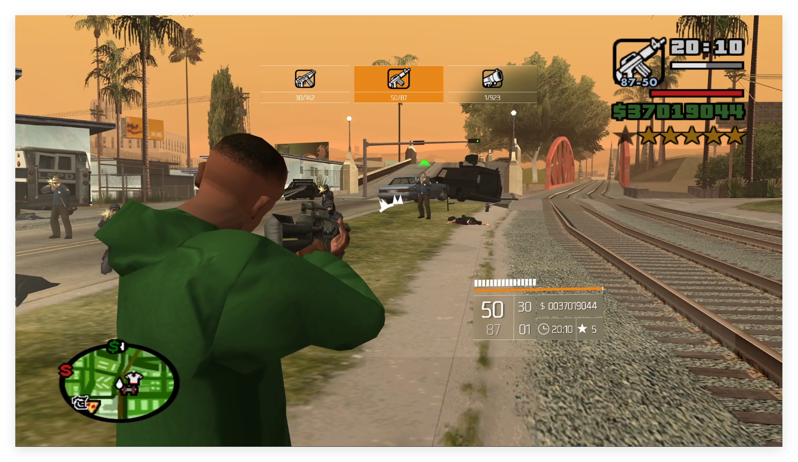

# DivisionHud4SA

在 GTA: San Andreas（1.0 US）上复刻《The Division 2》（全境封锁2）风格 HUD 的 ASI 插件，基于 [plugin-sdk](https://github.com/DK22Pac/plugin-sdk)。

## 效果



## 构建

### 环境要求

- Windows，[Visual Studio 2022 Build Tools](https://visualstudio.microsoft.com/visual-cpp-build-tools/)（MSVC v143 + Windows SDK）
- [CMake](https://cmake.org/) 3.21+
- [DK22Pac/plugin-sdk](https://github.com/DK22Pac/plugin-sdk)，Release 静态库 `%PLUGIN_SDK_DIR%\output\lib\Plugin.lib`
- 环境变量：
  - `PLUGIN_SDK_DIR`：plugin-sdk 根目录
  - `GTA_SA_DIR`：游戏目录（含 `gta_sa.exe`）

### 步骤

```powershell
cmake -S . -B build
cmake --build build --config Release -j 12
```

产物为 `%GTA_SA_DIR%\scripts\DivisionHud4SA.asi`，运行资源（着色器、字体）自动部署到 `%GTA_SA_DIR%\scripts\DivisionHud4SA\`。

## 安装

1. 安装 ASI Loader（推荐 [Ultimate-ASI-Loader](https://github.com/ThirteenAG/Ultimate-ASI-Loader)）。
2. 将构建产物 `DivisionHud4SA.asi` 放入游戏目录的 `scripts\` 文件夹。
3. 启动游戏。首次运行会在 `scripts\DivisionHud4SA\config\DivisionHud4SA.ini` 生成默认配置。

> 配置支持热重载，约半秒内生效；已改数值不会被覆盖。